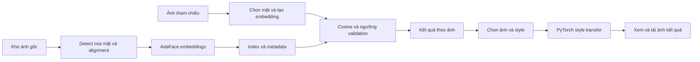

# F-Smart Memories: lựa chọn model, dữ liệu và hướng triển khai

Ngày đối chiếu nguồn: 14/10/2026. Bối cảnh: đồ án Face Recognition + Neural Style Transfer bằng PyTorch, có thể dùng Kaggle GPU. Đây là phương án kỹ thuật và kế hoạch thực nghiệm; chưa có kết quả benchmark trên ảnh của nhóm.

**Cập nhật triển khai:** Đã tạo ứng dụng local hoạt động, tải trọng số và kiểm tra model thật trên CPU. Xem `README.md` để chạy. Prototype hiện có AdaFace/MTCNN, bốn preset Fast Neural Style và NST ảnh style tùy chọn bằng VGG19. Sáu bài pytest đạt; demo công khai nhận được 1 + 1 + 2 mặt và hoàn tất search, chuyển style, tải PNG/ZIP. Kết quả này xác nhận chức năng, chưa thay thế benchmark độc lập trên ảnh của nhóm.

## 1. Quyết định triển khai

**Bản MVP:** MTCNN phát hiện khuôn mặt + AdaFace IR50/WebFace4M tạo embedding + tìm kiếm cosine + Fast Neural Style Transfer từ repo PyTorch chính thức. Tất cả phần suy luận Deep Learning của phương án này dùng PyTorch.

**Bản mở rộng:** StyTr² để nhận hai ảnh content/style bất kỳ. So sánh với Gatys/VGG19 làm baseline học thuật. Google Magenta là lựa chọn có nguồn từ Google nếu môn học cho phép TensorFlow.

Các model trên có trọng số pretrained hoặc backbone pretrained. Nhóm không cần tải lại dữ liệu huấn luyện gốc, cũng không cần train nhận diện từ đầu. Riêng Gatys tối ưu ảnh đầu ra theo từng cặp content/style; backbone VGG19 được giữ cố định. Đây không phải huấn luyện lại VGG19.

Không có bằng chứng để cam kết một model là chính xác nhất trên sinh viên FPT trước khi đo. AdaFace IR50 là lựa chọn khởi đầu cân bằng về nguồn phát hành, PyTorch và kích thước. Model cuối cùng phải qua bộ kiểm thử của nhóm.

## 2. Face Recognition

| Thành phần | Lựa chọn | Nguồn và lý do | Giới hạn cần biết |
|---|---|---|---|
| Detection | MTCNN trong facenet-pytorch | Có pretrained, trả box và 5 landmark, xử lý nhiều mặt | Cần đo khả năng tìm mặt nhỏ, nghiêng và bị che trong ảnh sự kiện |
| Recognition chính | AdaFace IR50 pretrained WebFace4M | Tác giả công bố qua CVLFace và tài khoản HF minchul; xuất embedding 512 chiều | Phải alignment và chuẩn hóa đúng checkpoint |
| Baseline | InceptionResnetV1 pretrained VGGFace2 | facenet-pytorch dễ dựng pipeline đối chứng | Repo cộng đồng của Tim Esler; không gọi là package chính thức của Google |
| Đối chứng thêm | InsightFace buffalo_l | SCRFD + nhận diện ArcFace trong bộ model được nhóm InsightFace phát hành | Python FaceAnalysis dùng ONNX Runtime; pretrained hạn chế ở nghiên cứu phi thương mại |

Nguồn: [facenet-pytorch](https://github.com/timesler/facenet-pytorch), [AdaFace chính thức](https://github.com/mk-minchul/AdaFace), [CVLFace](https://github.com/mk-minchul/CVLface), [InsightFace model zoo](https://github.com/deepinsight/insightface/blob/master/python-package/docs/model_zoo.md).

### Checkpoint AdaFace đã xác minh

- Model ID: `minchul/cvlface_adaface_ir50_webface4m`.
- [Model card và cách dùng của tác giả](https://huggingface.co/minchul/cvlface_adaface_ir50_webface4m).
- [Danh sách file](https://huggingface.co/minchul/cvlface_adaface_ir50_webface4m/tree/main): có `model.safetensors` khoảng 175 MB; toàn snapshot khoảng 349 MB do có thêm checkpoint trong thư mục con.
- Revision quan sát được: `60a65befbcf7e19284c4f3ac730f56867ed29594`.
- Input của bản CVLFace/HF này: mặt đã alignment, RGB, 112 x 112, chuẩn hóa mean/std đều 0.5.
- Bản AdaFace legacy trong repo cũ lại yêu cầu BGR. Không lấy preprocessing của bản cũ áp sang bản HF.
- Wrapper HF có đường dẫn tương đối và import code trong snapshot. Dùng loader đầy đủ theo model card; một dòng AutoModel do giao diện HF tự sinh có thể chưa đủ. `trust_remote_code=True` thực thi code của repo model: cố định revision và đọc code trước khi đóng gói.
- Model card yêu cầu tuân theo điều kiện của dữ liệu training; không suy ra trọng số được dùng thương mại chỉ từ MIT của source code.

Nguồn chi tiết: [config RGB](https://huggingface.co/minchul/cvlface_adaface_ir50_webface4m/blob/main/config.json), [wrapper](https://huggingface.co/minchul/cvlface_adaface_ir50_webface4m/blob/main/wrapper.py).

### Pipeline cần làm đúng

1. Đọc ảnh và sửa chiều xoay EXIF; thống nhất không gian màu theo từng model.
2. Phát hiện **mọi khuôn mặt** trong ảnh kho, lưu box, landmark và điểm detection.
3. Căn chỉnh bằng 5 landmark về template tương ứng checkpoint; không chỉ crop hình chữ nhật rồi resize.
4. Tạo embedding, chuẩn hóa L2, lưu cùng `photo_id`, `face_id`, `bbox`, `model_revision`.
5. Với selfie có nhiều mặt, giao diện cho người dùng chọn khuôn mặt muốn tìm.
6. Tính cosine similarity giữa query và các mặt đã lập chỉ mục.
7. Điểm của một ảnh là điểm cao nhất trong các mặt của ảnh đó. Gộp kết quả theo `photo_id`, tránh trả một ảnh nhiều lần.
8. Áp ngưỡng đã hiệu chỉnh trên validation. Khi không đủ điểm, trả trạng thái không có kết quả phù hợp.

`cosine = dot(q / ||q||, e / ||e||)`. Điểm này là mức tương đồng, không phải xác suất và không được hiển thị thành “95% chắc chắn”. Không lấy một ngưỡng trên Internet dùng chung cho AdaFace, FaceNet và ArcFace.

Với kho nhỏ, phép nhân ma trận NumPy/PyTorch là đủ để bắt đầu. Chỉ thêm FAISS khi benchmark cho thấy tìm kiếm là nút thắt. Lưu model version trong index; khi đổi encoder phải tạo lại embeddings.

## 3. Neural Style Transfer: chốt model và lựa chọn API

| Phương án | Nguồn phát hành | Trọng số | Nhận style ảnh tùy chọn? | Vai trò đề xuất |
|---|---|---|---|---|
| Fast Neural Style / TransformerNet | Repo pytorch/examples chính thức | Có saved_models; các preset Candy, Mosaic, Rain Princess, Udnie | Không; mỗi checkpoint ứng với một style đã học | MVP mặc định, dễ demo |
| Gatys với VGG19 | Tutorial và torchvision chính thức | VGG19 ImageNet pretrained | Có; tối ưu ảnh đầu ra theo từng yêu cầu | Baseline giải thích content/style loss |
| StyTr² | Repo chính thức của tác giả, CVPR 2022 | Có VGG, embedding, decoder, transformer | Có | Mở rộng sau khi MVP chạy ổn |
| Google Magenta Arbitrary Image Stylization | Google/TensorFlow | Có TF Hub model | Có | Lựa chọn từ tập đoàn lớn nếu được dùng TensorFlow |
| AdaIN PyTorch | naoto0804, implementation bên thứ ba | Có encoder/decoder trên GitHub Release | Có | Tham khảo thêm; repo đã archive |
| Stability AI Style Transfer API | API chính thức Stability AI | Dịch vụ quản lý model | Có | Dự phòng nếu cần API và chấp nhận gửi ảnh lên dịch vụ |

Nguồn: [Fast Neural Style](https://github.com/pytorch/examples/tree/main/fast_neural_style), [Gatys/VGG19 tutorial](https://docs.pytorch.org/tutorials/advanced/neural_style_tutorial.html), [torchvision VGG19](https://docs.pytorch.org/vision/stable/models/generated/torchvision.models.vgg19.html), [StyTr²](https://github.com/diyiiyiii/StyTR-2), [Google Magenta tutorial](https://www.tensorflow.org/hub/tutorials/tf2_arbitrary_image_stylization), [AdaIN PyTorch](https://github.com/naoto0804/pytorch-AdaIN), [Stability API reference](https://platform.stability.ai/docs/api-reference#tag/Control/paths/~1v2beta~1stable-image~1control~1style-transfer/post).

### Vì sao MVP chọn Fast Neural Style?

Nguồn code chính thức, có sẵn checkpoint và không cần tối ưu lặp trên từng ảnh. Giới hạn là chỉ chọn các style có checkpoint. Giao diện MVP nên ghi rõ “chọn phong cách” thay vì hứa tải bất kỳ tranh nào làm style.

Inference dùng TransformerNet đã train. VGG16 được dùng để tính perceptual loss khi train, không phải mạng trực tiếp tạo ảnh trong chế độ inference. Nếu muốn một style mới bằng hướng này, cần train thêm một checkpoint riêng; đó là việc tùy chọn sau MVP.

Script tải trọng số của tác giả nằm ở [download_saved_models.py](https://github.com/pytorch/examples/blob/main/fast_neural_style/download_saved_models.py). Nên tải một lần, giữ bản cache và ghi SHA-256 cho lần demo sau. Notebook đi kèm thực hiện bước này và thử inference.

### Khi nào dùng StyTr²?

Khi yêu cầu sản phẩm là người dùng tải cả ảnh content và ảnh style. Repo có bốn nhóm checkpoint và lệnh test, nhưng môi trường tham khảo khá cũ. Cần chạy thử trên Kaggle hiện tại, cố định phiên bản chạy được và kiểm tra điều kiện sử dụng code/weights trước khi phát hành ngoài đồ án. Chưa xác minh khả năng tải từng checkpoint hoặc inference thực tế trong phiên làm việc này.

Với ảnh kỷ niệm, phải đánh giá mặt, chữ và bố cục sau stylization. Model style transfer không bảo đảm giữ danh tính. Không mặc định mô hình mới hơn sẽ đẹp hơn cho mọi ảnh.

### Google và API bên ngoài

- Google Magenta nhận `content_image` và `style_image`; model handle theo tutorial: `https://tfhub.dev/google/magenta/arbitrary-image-stylization-v1-256/2`. Đây là model tải về chạy, không phải mặc định một REST API miễn phí. Backend là TensorFlow.
- Stability AI có endpoint `POST https://api.stability.ai/v2beta/stable-image/control/style-transfer`, gửi multipart với `init_image`, `style_image` và API key. Không gọi API trả phí trong phiên này; giá, credit và giới hạn cần xem trong tài khoản khi sử dụng.
- Với yêu cầu môn học, tự phục vụ model PyTorch qua FastAPI là hướng đề xuất. API bên ngoài có thể dùng làm đối chứng sản phẩm, nhưng không thay thế phần giải thích và đánh giá NST của nhóm.

## 4. Dữ liệu cần lấy và dùng vào việc gì

**Pretrained giải quyết việc huấn luyện. Dataset của nhóm dùng để xây kho ảnh, chọn ngưỡng và đánh giá.** Không cần tải hàng triệu ảnh WebFace4M/VGGFace2 chỉ để dùng checkpoint.

| Nguồn | Sử dụng phù hợp | Cách tiếp cận | Điều cần tránh |
|---|---|---|---|
| Ảnh thành viên/tình nguyện viên | Kho tìm kiếm và kiểm thử sát đề tài FPT | Nhóm tự thu thập, dùng mã người và ghi nhận đồng ý sử dụng | Chỉ test vài selfie chính diện |
| LFW | Kiểm tra pipeline nhận diện, benchmark phụ | Loader scikit-learn hoặc nguồn được loader dẫn tới | Coi điểm LFW là độ chính xác trên sinh viên Việt Nam |
| COCO 2017 validation | Ảnh content đa dạng cho thử NST | Trang COCO, 5.000 ảnh khoảng 1 GB | Dùng nhãn person của COCO làm nhãn danh tính |
| The Met Open Access | 10-20 tranh style có nguồn rõ ràng | API hoặc bộ sưu tập; chỉ lấy object có `isPublicDomain=true` và ảnh khả dụng | Suy ra mọi tác phẩm có metadata đều cho tải ảnh tự do |
| Smithsonian Open Access | Nguồn style bổ sung | Chọn asset gắn CC0 | Đồng nhất CC0 metadata với quyền mọi ảnh trong bộ sưu tập |
| Painter by Numbers / WikiArt | Mở rộng tập style cho thực nghiệm sau | Trang cuộc thi Kaggle, đọc điều kiện dữ liệu | Tải toàn bộ trước khi có nhu cầu; mặc định mọi tranh đều CC0 |

Nguồn: [LFW loader và thông số](https://scikit-learn.org/stable/modules/generated/sklearn.datasets.fetch_lfw_people.html), [COCO](https://cocodataset.org/#download), [COCO-Stuff download table](https://github.com/nightrome/cocostuff#downloads), [Met API](https://metmuseum.github.io/), [Smithsonian FAQ](https://www.si.edu/openaccess/faq), [Painter by Numbers](https://www.kaggle.com/competitions/painter-by-numbers).

LFW có 13.233 ảnh của 5.749 người theo scikit-learn. Để thử mạng RGB, không dùng mặc định loader ở ảnh xám và resize 0.5. Có thể dùng `color=True, resize=None, slice_=(slice(0,250), slice(0,250))`; LFW vẫn không đại diện cho bài toán phát hiện nhiều mặt trong ảnh sự kiện.

COCO validation tải từ URL được bảng download dẫn tới: `http://images.cocodataset.org/zips/val2017.zip`. Ảnh và annotation có điều kiện sử dụng khác nhau; giữ metadata license của từng ảnh khi dùng hoặc phân phối. Không cần tải toàn bộ COCO train cho MVP pretrained.

The Met hiện mô tả search phân trang `/public/collection/v1.1/search`; object detail vẫn ở `/public/collection/v1/objects/{objectID}`. Lưu `title`, `artist`, `objectURL`, `isPublicDomain` và URL ảnh vào manifest style. Tìm các tranh public domain có vân bút, màu và họa tiết khác nhau; chọn thủ công 10-20 tranh là đủ cho thử nghiệm đầu.

**Loại FFHQ khỏi dataset nhận diện:** README chính thức của NVIDIA nêu dữ liệu không dành cho phát triển hoặc cải thiện công nghệ nhận diện khuôn mặt. Không đề xuất FFHQ làm benchmark recognition của đồ án chỉ vì đến từ NVIDIA. [Nguồn NVIDIA](https://github.com/NVlabs/ffhq-dataset).

### Thiết kế dữ liệu nội bộ đề xuất

Các số dưới đây là mục tiêu thu thập, chưa phải dữ liệu đã có:

- Bắt đầu với 5 thành viên để kiểm tra chức năng; mở rộng lên khoảng 20-30 người tình nguyện nếu có thể.
- Khoảng 300-1.000 ảnh kho, gồm ảnh nhiều người, ánh sáng khác nhau, mặt nghiêng, kính và che khuất.
- Mỗi người có 3-5 ảnh query chụp khác buổi so với gallery.
- Có query của người không xuất hiện trong gallery để đo khả năng từ chối kết quả.
- Với style transfer, cố định khoảng 30 ảnh content và 10 style để so sánh; ảnh content gồm chân dung, ảnh nhóm, phong cảnh và ảnh có chữ.
- Giữ dữ liệu mặt trong Kaggle Dataset/Notebook riêng tư; không đưa ảnh và embedding thật vào Git công khai.

Mỗi face annotation cần `photo_id`, `face_id`, `person_id`, box và nhãn tình huống. Thêm `capture_session` và hash ảnh để phát hiện trùng. Ảnh có nhiều người có nhiều dòng annotation.

### Chia tập để tránh kết quả ảo

Không random ảnh gần trùng vào validation và test. Tách theo buổi chụp/event và cụm ảnh trùng. Query không xuất hiện trong gallery, kể cả dưới dạng crop hoặc ảnh resize.

Trong bài toán tìm ảnh, gallery và query có cùng người là chủ đích; khác nhau ở ảnh chụp. Khi đủ người, dùng nhóm danh tính riêng để chọn ngưỡng, rồi nhóm danh tính khác cho test. Mỗi nhóm đánh giá có gallery, known queries và unknown queries riêng. Nếu ít người, báo rõ hạn chế và dùng lặp theo người/buổi chụp; không tuyên bố tổng quát hóa rộng.

## 5. Kiến trúc sản phẩm

Đây là image retrieval theo khuôn mặt. MVP không cần cơ sở dữ liệu tên thật hoặc classifier theo danh sách sinh viên. Giữ ảnh gốc để lập chỉ mục; ảnh stylized là output riêng.

Stack đề xuất: Python + PyTorch/torchvision, FastAPI cho backend, giao diện demo Gradio hoặc Streamlit, SQLite cho metadata và `.npy/.npz` cho embeddings. Đây là lựa chọn triển khai của dự án, chưa phải ứng dụng đã được tạo.

Hợp đồng API dự kiến:

| Endpoint | Chức năng |
|---|---|
| `POST /albums/{album_id}/photos` | Nhập ảnh, tạo job lập chỉ mục |
| `POST /albums/{album_id}/search` | Nhận ảnh query và face selection; trả photo_id, box, similarity |
| `GET /styles` | Danh sách preset và backend hỗ trợ style tùy chọn |
| `POST /stylize` | Nhận photo_id + style_id, hoặc ảnh style nếu backend hỗ trợ; trả job_id |
| `GET /jobs/{job_id}` | Tiến độ và URL kết quả |

Đây là thiết kế ban đầu. API đã triển khai thực tế dùng prefix `/api`: tạo album, nhập ảnh, tạo query, search, stylize, theo dõi job và export. Hợp đồng chính xác xem Swagger `/docs` và README. Server prototype chạy local một người dùng; chưa có đăng nhập/phân quyền nhiều người.

## 6. Kaggle dùng để làm gì?

1. Kiểm tra GPU được cấp và phiên bản torch/torchvision của session; không giả định luôn có một loại GPU cố định.
2. Tải pretrained một lần khi có Internet. Lưu checkpoint, revision và SHA-256 thành artifact/dataset riêng để lần sau dùng lại.
3. Chạy inference, tạo embeddings, chọn threshold trên validation và benchmark NST.
4. Xuất index, config threshold, ảnh demo và kết quả CSV/JSON. Ghi seed, dependency versions, độ phân giải và phần cứng.
5. Demo app trên máy nhóm hoặc máy chủ riêng khi cần ổn định. Kaggle là môi trường thực nghiệm; kế hoạch này không phụ thuộc việc duy trì API công khai trong notebook.

Không cài lại toàn bộ torch/CUDA theo một README cũ ngay đầu notebook. facenet-pytorch có ràng buộc dependency khá hẹp, nên cần một lần kiểm tra môi trường cho phần recognition. [setup.py của tác giả](https://github.com/timesler/facenet-pytorch/blob/master/setup.py).

Notebook `notebooks/kaggle_pretrained_quickstart.ipynb` đi kèm thực hiện tải snapshot AdaFace và chạy demo Fast Neural Style từ code/weights của nguồn chính thức. Notebook chưa triển khai toàn bộ nhận diện hoặc ứng dụng. Chỉ được kiểm tra cấu trúc và cú pháp tại máy hiện tại; chưa chạy inference trên Kaggle.

## 7. Đánh giá và quyết định chọn model cuối

### Nhận diện và tìm kiếm

- Detection: recall trên các khuôn mặt gán nhãn, tách theo mặt nhỏ, nghiêng và bị che. Báo cả số trường hợp không tìm được mặt.
- Retrieval: Precision@5, Recall@K và mAP@K theo ảnh; lấy `person_id` đã gán nhãn làm ground truth. Không chỉ đánh giá crop đã detect thành công rồi bỏ qua mọi lỗi detection.
- Open set: tỷ lệ query người lạ vẫn bị trả kết quả, cùng tỷ lệ bỏ sót người có trong kho. Hiệu chỉnh ngưỡng trên validation, khóa ngưỡng trước test.
- Verification phụ: ROC/TAR/FAR nếu có đủ cặp và mô tả rõ protocol. Không suy ra FAR cực thấp từ vài trăm cặp.
- Hiệu năng: thời gian index mỗi ảnh và latency truy vấn; tách thời gian download/load model khỏi suy luận đã warm up.

Chạy ít nhất hai cấu hình trên cùng split: MTCNN + FaceNet baseline và MTCNN + AdaFace. Alignment phải đúng từng encoder. Nếu thử buffalo_l, báo cả khác biệt detector và runtime; đó là so sánh pipeline, không tách riêng chất lượng encoder.

### Style transfer

- Dùng cùng ảnh content, kích thước đầu ra và điều kiện đo. Preset chỉ so sánh trực tiếp khi các phương án dùng cùng tranh style; khác style cần ghi rõ.
- Đo latency sau warm up, bộ nhớ đỉnh và tỷ lệ lỗi. Khi dùng CUDA, synchronize trước/sau phần đo.
- Đánh giá người dùng: mức giữ nội dung, thể hiện style và mức hài lòng trên thang thống nhất; xáo trộn thứ tự, ẩn tên model.
- Content/style loss là chỉ số phụ phụ thuộc feature extractor và hệ số. PSNR/SSIM không phải điểm chất lượng nghệ thuật; không có một ảnh đích duy nhất cho NST.
- Có thể đo độ tương đồng mặt trước/sau như chỉ số chẩn đoán, nhưng không coi đó là bằng chứng chắc chắn giữ danh tính và không dùng mỗi chỉ số đó để xếp hạng nghệ thuật.

Mục tiêu nghiệm thu ban đầu có thể đặt Precision@5 >= 0.90 và Recall@20 >= 0.80 trên tập nhóm, nhưng phải thống nhất sau pilot, ghi kích thước gallery và số ảnh liên quan. Đây là mục tiêu dự kiến, không phải kết quả đạt được. Chưa đặt cam kết latency đến khi có số đo phần cứng.

## 8. Tiến độ đề xuất cho nhóm 5 người

Thời lượng bốn tuần là phương án để điều chỉnh theo deadline thực tế.

| Giai đoạn | Kết quả cần có |
|---|---|
| Tuần 1 | Thu dữ liệu pilot, chạy pretrained, cố định môi trường; chứng minh tìm được ảnh và tạo được ảnh NST |
| Tuần 2 | Index nhiều mặt, search theo ảnh, validation threshold, baseline FaceNet/AdaFace |
| Tuần 3 | Tích hợp demo, preset NST; thử StyTr² nếu phần cốt lõi đã ổn |
| Tuần 4 | Khóa model/config, test độc lập, bảng kết quả, video demo và báo cáo |

Phân công theo đầu việc: một người data/evaluation, một người detection/recognition, một người NST, một người backend/index, một người giao diện/tích hợp. Mọi người cùng tham gia giải thích model và phân tích lỗi.

Phần đóng góp học thuật hợp lý là so sánh pretrained, đánh giá ảnh sự kiện nội bộ, hiệu chỉnh ngưỡng và phân tích trade-off chất lượng/tốc độ. Không trình bày pretrained như model tự huấn luyện của nhóm.

## 9. Việc làm tiếp theo đã được xác định

1. Upload notebook khởi động lên Kaggle, bật GPU và Internet, tải/kiểm tra checkpoint.
2. Thu pilot với 5 thành viên, tách ảnh gallery/query theo buổi chụp.
3. Dựng pipeline MTCNN + AdaFace với alignment đúng; so sánh FaceNet trên cùng dữ liệu.
4. Hoàn thiện preset NST và bản demo tìm ảnh -> chọn ảnh -> stylize -> tải xuống.
5. Chỉ nâng cấp arbitrary style sau khi đã có bản demo và bảng benchmark cơ bản.

Đã thực hiện: tải và nạp checkpoint AdaFace, MTCNN, bốn preset và VGG19; kiểm thử inference thật, API và giao diện local. Model nguồn và checksum được ghi ở `weights/provenance.json`; báo cáo chức năng ở `artifacts/smoke/report.json`. Notebook `kaggle_full_project.ipynb` dùng source ứng dụng hoàn chỉnh. Chưa chạy trên Kaggle thực tế, chưa gọi API trả phí và chưa có benchmark độc lập trên ảnh sinh viên FPT. Không có dữ liệu nội bộ nào được tự thu thập hoặc công khai.

Bổ sung ngày 15/10/2026: chatbot hỗ trợ trong giao diện, có FAQ hoạt động ngay và tích hợp [OpenAI Responses API](https://developers.openai.com/api/docs/guides/text), model mặc định [GPT-5.4 Mini](https://developers.openai.com/api/docs/models/gpt-5.4-mini). API key nhập trong Cài đặt GPT được giữ trong RAM backend đến khi tắt server; có thể dùng biến môi trường thay thế. GPT chỉ nhận văn bản hội thoại, tên trang và mã style; không tự nhận ảnh hay embedding. Đã bổ sung chat mô tả phong cách → đề xuất → tạo ảnh bằng preset hoặc ảnh style tham chiếu mới qua OpenAI rồi VGG19 cục bộ. Xem TEXT_STYLE_CHAT.vi.md. Tổng 52 kiểm thử đạt; GPT và API ảnh được kiểm thử giả lập, chưa gọi thật vì chưa có key. Hướng dẫn cấu hình và giới hạn nằm trong README.
