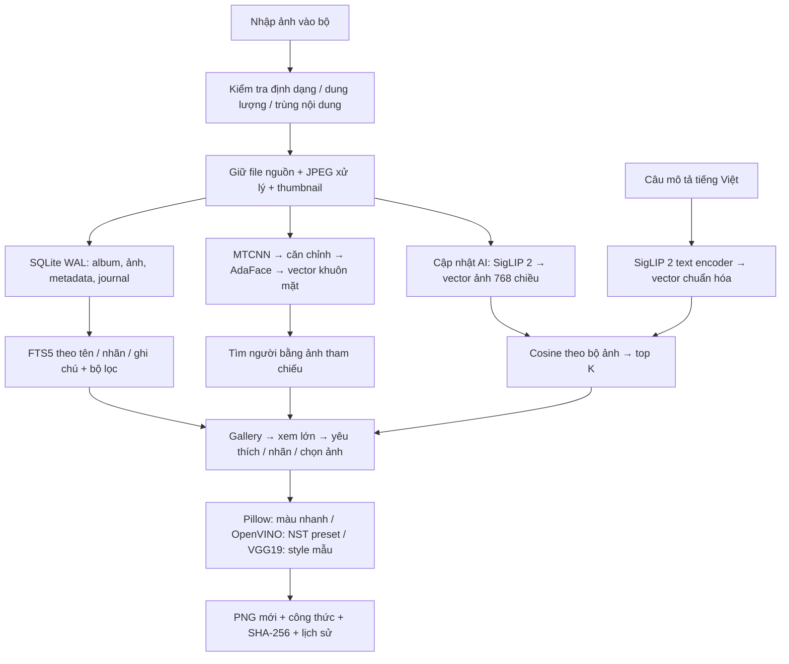

# Nâng cấp thư viện và sáng tạo — 15/10/2026

Đợt này chuyển trọng tâm từ demo nhận diện/NST thành quy trình quản lý ảnh dùng được: tổ chức → tìm lại → xem và ghi nhớ → sáng tạo → lưu phiên bản. Các mục dưới đây đã có API và giao diện trong ứng dụng local. Những model mới chỉ được nghiên cứu được ghi riêng trong `research/TRUSTED_REPOS.vi.md`.

## Dùng ngay

Mở `Chay-FSmart.cmd` trong `D:\prjdpl`, hoặc truy cập [ứng dụng](http://127.0.0.1:8000/) nếu server đang chạy. Mở một bộ ảnh rồi chọn mục **Ảnh**.

1. **Tìm bằng mô tả:** nhập “ảnh tập thể sinh viên”, “chân dung một người” hoặc điều bạn nhớ vào ô AI. Model đã có trọng số; 68 ảnh hiện tại đã lập chỉ mục. Bộ mới bấm **Cập nhật AI** trước. Mỗi lượt hiện tối đa 24 ảnh gần nhất, có thể xem thêm tới 100.
2. **Tìm và lọc thông tin:** ô Tên, nhãn hoặc ghi chú dùng tìm toàn văn cục bộ, không gọi model. Có lọc yêu thích, khung ảnh dọc/ngang, số mặt và sắp xếp theo tên/thời gian nhập. Ví dụ nhãn “Kỷ yếu” tìm được bằng “ky yeu”. Ký tự đ/d là hai chữ khác nhau trong tokenizer; tìm theo từ/prefix, không phải tìm mọi chuỗi con.
3. **Xem ảnh:** bấm ảnh để mở lớn. Thêm nhãn phân cách bằng dấu phẩy, ghi chú rồi **Lưu thông tin**. ←/→ đổi ảnh trong các ảnh đang hiển thị; F đổi yêu thích, E mở sáng tạo, Esc đóng. Khi đang gõ thông tin, các phím chữ giữ tác dụng nhập văn bản. Rời thông tin chưa lưu sẽ có nhắc.
4. **Ảnh tương tự:** trong trình xem lớn bấm Tìm ảnh tương tự. Đây là giống về nội dung/hình ảnh, không phải xác nhận cùng người. Muốn tìm cùng người dùng mục Tìm khuôn mặt.
5. **Yêu thích nhiều ảnh:** chọn checkbox rồi đánh dấu yêu thích. Khi đang lọc yêu thích, cùng nút đó bỏ yêu thích hàng loạt.
6. **Thử màu:** trong Sáng tạo có bảng màu phía dưới công cụ NST. Chọn ảnh gốc hoặc tác phẩm đang xem, chọn màu và kéo độ đậm. Preview 640 px, bấm Lưu phiên bản màu để tạo PNG tối đa 2048 px. Có sáu lựa chọn gồm nguyên bản và năm xử lý màu. Ảnh đầu vào được giữ nguyên; PNG mới có công thức và checksum.
7. **Ctrl K:** mở bảng tìm thao tác: bộ mới, yêu thích, tìm mô tả, nhận diện, sáng tạo hoặc kiểm tra hệ thống.

## Pipeline thực tế



Không train lại SigLIP 2 hay AdaFace cho thao tác thường ngày. SigLIP 2 dùng encoder ảnh và văn bản của cùng checkpoint Google; không dịch câu sang tiếng Anh bằng API. Không đưa kho ảnh lên Hugging Face. Mạng chỉ cần lúc cài/tải trọng số; inference dùng file local.

Tìm AI giữ một worker, từ chối yêu cầu trùng khi đang bận với HTTP 429. Chỉ mục ghi sau từng ảnh. Nếu server dừng giữa chừng, job được đánh dấu gián đoạn; bấm Cập nhật AI để tiếp tục phần thiếu. Ảnh đã có vector cùng digest/model được bỏ qua. Vector hỏng được tính lại khi cập nhật. Ảnh ở Thùng rác không tham gia tìm; khôi phục dùng lại vector. Xóa vĩnh viễn dọn bản ghi vector bằng khóa ngoại.

Metadata có số phiên bản để phát hiện hai nơi chỉnh cùng lúc, trả 409 thay vì âm thầm ghi đè. Đánh dấu nhiều ảnh là một transaction: có ảnh không hợp lệ thì toàn bộ thao tác rollback. FTS5 đồng bộ bằng trigger khi nhập/đổi tên/sửa metadata/xóa ảnh. Bước seed dữ liệu cũ chỉ chạy một lần theo migration.

## Database và quy mô

SQLite WAL tiếp tục phù hợp triển khai một máy, không cần cài một server database khác để mở ứng dụng. Bổ sung:

| Cấu trúc | Mục đích |
|---|---|
| `photo_metadata` | Yêu thích, nhãn JSON, ghi chú, số phiên bản cập nhật |
| `photo_search` FTS5 | Tìm từ/prefix theo tên, nhãn, ghi chú; bỏ dấu thanh với unicode61 |
| `semantic_embeddings` | Vector float32, photo digest và checkpoint key cố định |
| `schema_migrations` | Đánh dấu migration bổ sung; không reset dữ liệu cũ |
| Index `faces_photo`, `photo_favorites`, `semantic_model` | Giảm quét cho lọc mặt, yêu thích và truy vấn model |

Cosine đọc vector từng nhóm 256 và heap top K; không nạp toàn bộ ảnh hoặc toàn bộ ma trận vào RAM khi tìm. Đây vẫn là tìm chính xác tuyến tính theo số vector, chưa có ANN. Chưa benchmark quy mô hàng triệu ảnh hoặc nhiều người truy cập. Khi triển khai nhiều tài khoản: cần xác thực, phân quyền theo bộ ảnh, kho object, PostgreSQL và chỉ mục vector chuyên dụng, worker độc lập và kiểm thử tải. Những phần đó chưa được triển khai ở bản local này.

## Kết quả kiểm nghiệm

Bằng chứng máy đọc được ở `artifacts/modern/`: `tests.xml`, `benchmark.json`, `live-system.json`. Ảnh giao diện ở `artifacts/ui/modern-*.jpg`. Bộ kiểm thử dùng ảnh tổng hợp, model giả để kiểm tra logic; inference thật được chạy riêng trên 68 ảnh hiện có.

Nghiệm thu toàn bộ: **117/117 ca đạt trong 47,58 giây**, có một cảnh báo deprecation từ Starlette TestClient/httpx, không có test thất bại. Sau tối ưu bước seed migration, chạy lại riêng 15 ca nâng cấp đều đạt.

| Phép đo thật trên i7-13620H, PyTorch CPU, 4 luồng | Kết quả |
|---|---:|
| Lập chỉ mục nội dung lần đầu, gồm nạp model | 68/68 ảnh; 34,327 giây; 0 lỗi |
| Vector hợp lệ | 68 vector × 768 chiều, hữu hạn và chuẩn hóa |
| Tìm mô tả khi model đã nạp, 3 câu | 0,047–0,091 giây ở server; trung vị 0,060 giây |
| Preview màu 640 px, HTTP local, 3 màu | 0,0873–0,1016 giây; trung vị 0,0905 giây |
| Đối chiếu thư viện trước/sau | 68 photo ID/album/digest giữ nguyên |

Phép đo preview tính cả mở JPEG và HTTP trên một ảnh cụ thể, không đại diện mọi ảnh/máy. Thời gian tìm chưa bao gồm tải ảnh vào trình duyệt; khởi động model lần đầu chậm hơn khi đã nạp. 68 ảnh này không phải bộ đánh giá retrieval độc lập.

Sau khởi động lại server, truy vấn đầu trong giao diện mất 7,112 giây do nạp model; lượt xem thêm tiếp theo mất 0,078 giây. Đã kiểm tra UI trả 24 rồi 48 kết quả và dùng lại chỉ mục đã lưu, không chạy lại encoder ảnh. Bằng chứng thao tác ghi ở `artifacts/modern/ui-checks.json`.

Kiểm thử bao phủ metadata lưu bền, nhãn có dấu/không dấu, rollback lô, xung đột phiên bản, phân trang, lọc, scope bộ/thùng rác, chỉ mục tăng dần, stale digest, vector NaN, khóa bận, thiếu model, xếp hạng bằng oracle ảnh tổng hợp, nguồn màu sai bộ, bất biến ảnh nguồn và checksum/công thức đầu ra. Hệ thống cũng kiểm tra vector nội dung và FTS/metadata cùng kiểm tra file trước đây.

Giao diện đã thao tác thật ở desktop 1440×950 và kích thước điện thoại 430×900: mở ảnh lớn, lưu nhãn/ghi chú, yêu thích, tìm không dấu, không có kết quả, bảng thao tác, chuyển sáng tạo, xem trước/lưu màu. Tìm câu tiếng Việt chạy trên model thật trong ứng dụng cổng 8000. Các thao tác sửa dữ liệu thử chạy cổng 8001 riêng.

## Giới hạn cần nắm

- Chưa đánh giá Recall@K/mAP trên tập độc lập có gán nhãn tiếng Việt. Điểm cosine là xếp hạng nội dung, không phải xác suất đúng; app vẫn có thể trả ảnh không liên quan khi mô tả nằm ngoài bộ.
- SigLIP 2 gói tải khoảng 1,54 GB, model nạp vào RAM riêng. Chưa lượng tử hóa hoặc xuất OpenVINO cho encoder này; không tuyên bố tốc độ thiết bị chuyên dụng.
- Màu Pillow có thể xem trước nhanh nhưng không tạo họa tiết mới. NST preset vẫn dùng model chuyển phong cách; thay nền/chỉnh đối tượng theo prompt cần pipeline khác.
- OpenAI chat và ảnh tham chiếu từ mô tả vẫn là tùy chọn cần API key/hạn mức. Đợt này không gọi API có phí.
- Các ảnh nhập ở bản cũ vẫn có giới hạn chỉ còn JPEG đã lưu; không thể tái tạo byte upload gốc. Không có chỉnh sửa có thể khôi phục dữ liệu đã mất từ trước.

## Cài lại phần tìm AI

Trong máy hiện tại đã cài và tải xong. Máy khác chạy setup mặc định sẽ cài thêm tìm kiếm AI. Có thể dùng `-SkipSemanticSearch` để bỏ qua. Nếu chỉ bổ sung vào môi trường đã có:

```powershell
.\.venv\Scripts\python.exe -m pip install -r requirements-semantic.txt
.\.venv\Scripts\python.exe scripts/fetch_semantic.py
```

Sau đó khởi động lại app, mở bộ ảnh → Cập nhật AI. Script pin revision `75de2d55ec2d0b4efc50b3e9ad70dba96a7b2fa2`, tải file dữ liệu/safetensors, so SHA-256 LFS với Hub và ghi manifest. Inference kiểm tra manifest, `local_files_only=True`, `trust_remote_code=False`, `use_safetensors=True`. Khuyến cáo định dạng này theo [chính sách bảo mật Transformers](https://github.com/huggingface/transformers/blob/main/SECURITY.md); không phải cam kết phần mềm miễn mọi rủi ro.


## Cập nhật 15/10/2026

Đã tích hợp SAM 2.1 Tiny chọn chủ thể, Qwen chat local GGUF Q8, Studio ba tab và preview preset thực. Các mô tả SAM còn là đề xuất ở bản ngày trước được thay bằng triển khai này. Xem [báo cáo kiểm tra mới](STRICT_REVIEW_2026-10-15.vi.md) để biết pipeline, tốc độ, nguồn và giới hạn.
