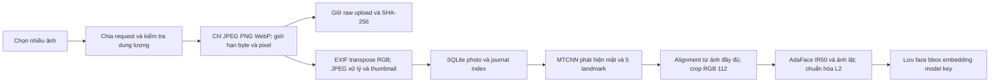
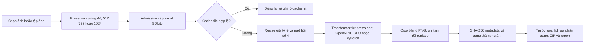

# Kiểm toán và nâng cấp F-Smart Memories — 15/10/2026

Đã sửa các lỗi tái hiện được, bổ sung vận hành và kiểm tra bằng model thật trên CPU. Kết quả hiện tại phù hợp demo local và xử lý album cá nhân. Chưa đủ bằng chứng để công bố accuracy nhận diện hoặc khả năng phục vụ nhiều người trên Internet. Không dùng số bài test để gọi hệ thống “hoàn hảo”.

## Kết quả đo và phạm vi bằng chứng

| Phép kiểm | Kết quả | Ý nghĩa và giới hạn |
|---|---|---|
| Bộ test ban đầu | 59 bài đạt | Vẫn bỏ sót các lỗi được bổ sung bên dưới |
| Năm test hồi quy mới, chạy trước khi sửa | 5/5 thất bại | Tái hiện lỗi thật, không chỉ kiểm tra code mới |
| Toàn bộ test sau sửa | 84 bài đạt | API, queue, dữ liệu, lỗi, đánh giá và nhánh GPT giả lập |
| Lô hai ảnh chọn bằng checkbox | 2/2, 0 lỗi, 0 cache | Xác nhận chọn một phần album và xử lý thật |
| Lô 68 ảnh thật, Mosaic 75%, 512 px | 68/68, 0 lỗi, 0 cache; 21,866 giây | OpenVINO CPU FP32 đã nạp model; gồm xử lý và lưu từng output, không gồm upload/lập chỉ mục/đóng ZIP |
| ZIP của lô 68 | 68 PNG, CRC đạt; 34.516.064 byte | Đã decode từng PNG; cạnh dài tối đa 512, giữ tỷ lệ |
| Toàn vẹn thư viện đang chạy | 68 ảnh, 453 mặt; không phát hiện lỗi trong các kiểm tra đã chạy | Kiểm tra DB/file/embedding không chứng minh danh tính đúng |
| Pillow 10.4 → 12.3 | Cùng bbox, 1 mặt, cosine embedding trước/sau ≈ 0,999999965 | Một query thật; chỉ là kiểm tra hồi quy trên mẫu nhỏ |
| Giao diện | 430 px và 1440 px không tràn ngang; lịch sử tải đủ 81 output | Không thay cho ma trận thiết bị/trình duyệt đầy đủ |

Máy đo: Intel Core i7-13620H, PyTorch 2.8.0+cpu, OpenVINO 2026.4.1, 4 luồng cho mỗi runtime. Máy còn chạy phần mềm khác. **3,11 ảnh/giây là một lần đo trên lô này**, không phải SLA hoặc kết quả trên FPGA/NPU. Lần đầu nạp/compile model lâu hơn; không gộp cache hit với tốc độ suy luận.

Bằng chứng cục bộ ở `artifacts/audit/before.xml`, `after.xml`, `live-system.json`, `pillow-regression.json` và `artifacts/ui/audit-system.jpg`. Các artifact có thể chứa metadata riêng và không nằm trong source ZIP. Script `scripts/audit_live.py` kiểm tra lại ZIP và toàn vẹn của lô gần nhất đã hoàn tất; script không tạo lô hoặc gọi API trả phí.

Bộ test còn một cảnh báo deprecation của Starlette TestClient khi dùng httpx; chưa gây lỗi chạy, cần theo dõi khi nâng dependency tiếp theo. Mục toàn vẹn không có dữ liệu để đối chiếu hiển thị “CHƯA CÓ” và số mục đã kiểm tra, thay vì gắn nhãn đạt cho 0 bản upload gốc.

## Lỗi đã sửa và cách kiểm chứng

| Vấn đề | Thay đổi | Kiểm chứng |
|---|---|---|
| Toàn bộ ảnh trong lô lỗi nhưng vẫn báo thành công | Phân biệt lỗi toàn bộ, hoàn tất một phần và dừng | Test hồi quy all-failed; lỗi từng ảnh vẫn cho ảnh khác tiếp tục |
| Cache có PNG hỏng vẫn được dùng | Metadata byte/SHA-256; kiểm tra trước khi tái dùng; tạo lại khi cần | Sửa byte PNG rồi gọi lại phải tái suy luận |
| File kết quả bị mất trả lỗi 500 | Trả 404 có hướng dẫn tạo lại | Xóa file trong fixture tạm rồi gọi endpoint |
| Gửi lại yêu cầu tạo ảnh sinh việc trùng | Idempotency-Key và transaction kiểm tra tham số | Cùng key/cùng tham số trả cùng job; khác tham số trả 409 |
| Embedding NaN hoặc sai chiều làm tìm kiếm lỗi | Kiểm tra vector, trả 409 có hướng dẫn lập chỉ mục lại | BLOB hỏng và NaN trong fixture; scope outdated chọn đúng ảnh |
| Tiến độ index mất sau gián đoạn | Journal `index_items` theo từng ảnh; phục hồi phần chưa xong | Khôi phục queue không tính lại item đã hoàn tất |
| Kết quả tạo ảnh về muộn gắn lên ảnh khác | Chốt photo ID lúc gửi; chỉ cập nhật preview nếu vẫn chọn ảnh đó | Trình duyệt tạo ảnh A 1024 px rồi đổi ngay sang B: B không hiện output A |
| Ảnh upload bị đổi thành JPEG nhưng được gọi là file gốc | Lưu raw upload riêng, checksum và preview chuẩn hóa riêng | Download bằng đúng byte; kiểm tra EXIF và manifest ZIP |
| Tải nhiều ảnh/ZIP gây tăng bộ nhớ | Upload nhóm ≤12 file/96 MB; ZIP trên đĩa; browser dùng URL download | Test export Range/byte chính xác; mở ZIP 68 output thật |
| Thiếu ổ đĩa vẫn nhận công việc lớn | Ước tính trước, chừa 128 MB, trả 507; lô đang chạy có thể dừng | Mô phỏng disk pressure, không sinh bản nhập dở hoặc ZIP thừa |
| Tiếp tục nhiều lô vượt giới hạn khi đồng thời | Kiểm tra lại trong transaction | Test concurrent resume giữ tối đa 4 lô hoạt động |
| Bảo vệ CSP làm Swagger không tải được | CSP riêng cho docs, hash chính xác inline boot code | Test hash; mở `/docs` thật thấy schema và endpoint; app chính giữ script self |

Không xóa ảnh thật để test lỗi. Các bài thử phá file/DB hoặc kiểm tra delete dùng thư mục tạm do pytest tạo.

## Pipeline nhập và nhận diện

Upload hoàn tất không đồng nghĩa nhận diện đã xong. Frontend theo dõi tác vụ index và cập nhật số mặt. Một ảnh lỗi không hủy cả album. Scope lập chỉ mục: `failed` chỉ ảnh lỗi; `outdated` gồm sai model/pipeline và vector hỏng; `all` tính lại tất cả. Không giảm kích thước crop gốc hoặc đổi ngưỡng để làm đẹp tốc độ style.

Ảnh query đi qua cùng pipeline. Tìm cosine chính xác theo từng khối 1.024 face, lấy mặt tốt nhất mỗi ảnh rồi top-K. RAM không cần giữ ma trận của toàn kho. Đây vẫn là tìm kiếm tuyến tính; khi số face lên hàng triệu cần benchmark rồi mới chọn FAISS/HNSW và đo lại recall.

Model key gắn checkpoint và preprocessing. Không trộn embedding khác model key. Ngưỡng 0,40 hiện tại là giá trị vận hành, chưa phải ngưỡng tối ưu được chứng minh trên dữ liệu nhóm.

## Pipeline tạo phong cách

Một worker style xử lý từng ảnh để giới hạn RAM, nhường lượt giữa ảnh. Tối đa 4 lô hoạt động và 20 job tạo một ảnh đang chờ/chạy. Tạm dừng hoàn tất ảnh hiện tại; tiếp tục bỏ qua ảnh đã xong và còn hợp lệ. “Kết thúc lô” đóng phần còn lại, giải phóng ràng buộc ảnh; lô đã đóng không thể tiếp tục. Lỗi model hoặc file được ghi từng ảnh, không thay bằng ảnh giả.

Cache phân biệt ảnh, preset, cường độ, kích thước, trọng số và phiên bản xử lý/Pillow. OpenVINO giữ tối đa 2 model đã compile trong RAM. Đổi Pillow hoặc fingerprint có thể cần compile lại. Chỉ preset feed-forward đi theo luồng nhanh này.

## Pipeline chatbot

Mô tả → trợ lý đề xuất kế hoạch style → server kiểm tra và giữ kế hoạch → người dùng bấm tạo → queue áp dụng lên ảnh đang chọn.

Hai cách xử lý được hiển thị rõ:

1. Preset: chọn Candy/Mosaic/Rain Princess/Udnie và cường độ từ mô tả. Chưa cấu hình key thì dùng quy tắc cục bộ có gắn nhãn. Chạy model local, không cần API ảnh.
2. Style tham chiếu mới: API ảnh tạo một tranh style từ văn bản, sau đó VGG19 NST tối ưu ảnh ở local. Chậm hơn preset và có chi phí API khi cấu hình. Ảnh người dùng không được gửi sang API trong luồng hiện tại; API nhận mô tả để tạo tham chiếu.

Kế hoạch không cho client tự sửa tùy ý các tham số đã được server duyệt. ID công việc có cả profile: đổi 512 sang 1024 phải có kết quả đúng kích thước. Key API chỉ giữ trong RAM, mất khi restart. Audit này **không gọi API GPT/ảnh thật** vì chưa có key; timeout/lỗi/schema của nhánh đó được kiểm tra bằng mock.

## Chức năng vận hành và cách dùng

- Thư viện: checkbox → chọn vài ảnh hoặc “Chọn ảnh đang hiển thị” → “Sáng tạo ảnh đã chọn” → chọn preset và kích thước → tạo lô. Có đổi tên album và tải nguồn đã chọn.
- Hệ thống: CPU/backend/disk, số ảnh/mặt, tác vụ và tiến độ thật; kiểm tra SQLite, foreign key, ảnh đọc được, checksum, vector; khôi phục riêng thumbnail thiếu/hỏng.
- Tác phẩm: lịch sử theo album, 50 mục mỗi lượt, nút xem thêm, kích thước thật của output; tải PNG hoặc ZIP có report.
- Queue: phục hồi index và batch qua SQLite. Job tạo một ảnh bị gián đoạn được báo lỗi để người dùng tạo lại; không tự gọi lại API trả phí sau restart.
- File gốc nhập sau nâng cấp: `/api/photos/{id}/original` trả raw upload. Ảnh nhập từ bản cũ có header `X-Original-Available: false`, ZIP có `byte_original: false`.

**68 ảnh hiện có là dữ liệu từ bản cũ**: chỉ còn JPEG đã lưu trước nâng cấp. Không thể lấy lại raw upload từ JPEG đó. Cần nhập lại từ file nguồn nếu nhóm yêu cầu bảo toàn byte ban đầu. Không tự xóa dữ liệu cũ hoặc tuyên bố đã khôi phục được.

Chạy Windows: nhấp đúp `Chay-FSmart.cmd` hoặc `.\run.ps1`, mở `http://127.0.0.1:8000`. Chế độ thường giữ cửa sổ server mở. Có thể dùng `.\.venv\Scripts\python.exe scripts/launch.py --background --no-browser`; log ở `runtime/logs/`. Nếu hệ điều hành hoặc ứng dụng chủ kết thúc tiến trình, cần chạy launcher lại; queue phục hồi từ dữ liệu đã ghi.

## Các điểm chưa đạt mức triển khai rộng

| Mức | Phần còn thiếu | Điều kiện để công bố đã đạt |
|---|---|---|
| Cao | Accuracy trên dữ liệu nhóm; ảnh nghiêng, xa, mờ, người lạ | Ground truth độc lập, calibration/test tách biệt; công bố Precision/Recall/mAP và false match |
| Cao khi triển khai Internet | Auth, phân quyền, quota theo người, lưu key, TLS | Thiết kế multi-user và kiểm thử cách ly; hiện chỉ bind localhost |
| Cao cho dữ liệu quan trọng | Backup/restore toàn bộ dữ liệu được diễn tập; fault injection cắt điện | Bản sao DB/files có manifest, thử restore và đối chiếu; journal không thay backup |
| Vừa | GPT/Images chạy thật | Có key và yêu cầu thử rõ ràng; đo chất lượng, lỗi mạng, latency, chi phí thật |
| Vừa | Album rất lớn, nhiều thiết bị | Chưa đo ML 10.000 ảnh; chỉ test điều phối 200 ảnh bằng model giả và 68 ảnh ML thật |
| Vừa | CPU/NPU/FPGA khác, INT8 | Đo cùng độ phân giải và sai lệch chất lượng; không suy từ CPU này sang chip khác |
| Vừa | UX tải dài, mạng treo, nhiều tab | Cần thêm kiểm thử timeout/soak và trình duyệt khác; hiện có reconnect theo dõi job |
| Thấp | Bảo trì code và ticket export | Còn closure index cũ không được gọi; URL ZIP nguồn tối đa 4 ticket trong RAM, TTL 1 giờ, cần chuẩn hóa quản lý vòng đời nếu dùng nhiều |

File và SQLite không thể cùng atomic khi máy mất điện đúng lúc commit. Ghi file tạm, checksum và journal giảm rủi ro; vẫn cần backup/restore và kiểm thử sự cố vật lý. Chẩn đoán toàn vẹn chỉ kiểm tra các điều kiện đã nêu, chưa tìm mọi file mồ côi hoặc mọi kiểu hỏng metadata.

## Nguồn và tiêu chuẩn cho lần nâng cấp tiếp

Giữ nguồn trọng số tác giả: [PyTorch Fast Neural Style](https://github.com/pytorch/examples/tree/main/fast_neural_style), [CVLFace AdaFace IR50 model card](https://huggingface.co/minchul/cvlface_adaface_ir50_webface4m), [MTCNN source](https://github.com/timesler/facenet-pytorch). URL/revision/hash nằm trong `weights/provenance.json`. [Pillow 12.3 release notes](https://pillow.readthedocs.io/en/stable/releasenotes/12.3.0.html) và [security advisories](https://github.com/python-pillow/Pillow/security/advisories) là nguồn kiểm tra cập nhật; decoder của app còn giới hạn JPEG/PNG/WebP trước khi mở ảnh.

Xem [tiêu chuẩn nghiệm thu](QUALITY_STANDARD.vi.md), [đo CPU](CPU_PERFORMANCE.vi.md), [lựa chọn model/data](F_SMART_MEMORIES_PLAN.vi.md) và [hướng dẫn chạy](../README.md). Những tài liệu này tách rõ kết quả đo được, giả định và việc chưa kiểm chứng.
